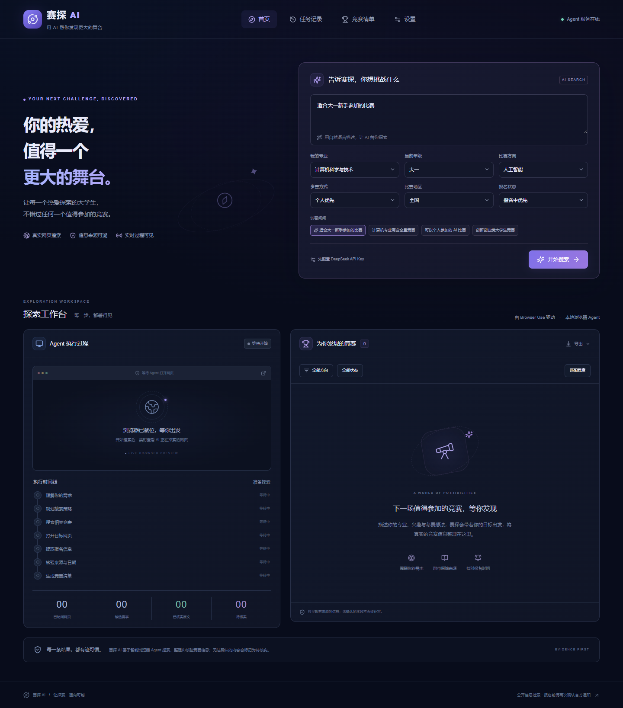

# 赛探 AI · SaiTan AI

大学生竞赛智能搜索与信息整理助手。基于 **Next.js + FastAPI + Browser Use 本地浏览器**，按用户需求浏览公开网站、保存原文证据、展示真实执行事件，生成可追溯的竞赛清单。

**验收状态：READY FOR DEMO（本地演示）。** 已配置并实测 DeepSeek，限定赛事核验正常完成；真实网页访问、原文保存、进度、导出、取消和超时均已验证。广泛搜索得到 3 条真实记录但覆盖不足，任务诚实标记“部分成功”。没有把测试夹具当作生产赛事，不保证每次都能找到正在报名的比赛。详见 [开发报告](docs/development-report.md)。



## 本地运行（Windows）

需要 Node.js 22+、Python（用于安装 uv）、本机 Chrome/Chromium，以及可用的 DeepSeek API Key。项目由 uv 自动安装/选择 Python **3.12**，已固定 Browser Use **0.13.11**，Python 与 npm 均有锁文件。

```powershell
cd 'C:\Users\QYF\Desktop\comp ai'
powershell -ExecutionPolicy Bypass -File .\scripts\setup.ps1
powershell -ExecutionPolicy Bypass -File .\scripts\start.ps1
```

打开 [赛探首页](http://127.0.0.1:3000)，到[设置](http://127.0.0.1:3000/settings)填写密钥，点击保存，再测试模型连接。

默认模型为 `deepseek-flash`，Base URL 为 `https://api.deepseek.com/v1`。这是 DeepSeek V4.1 Flash 官方 API ID；不是 `deepseek-v4.1flash`。模型调用费用由你的服务商账户承担。

开始搜索示例：**寻找适合大一学生参加的人工智能相关比赛。** 根据执行时间线观察访问页面，点击结果中的“查看详情与核验证据”检查原文。缺失的日期、参赛条件不会自动补写。

停止脚本启动的服务：

```powershell
powershell -ExecutionPolicy Bypass -File .\scripts\stop.ps1
```

不希望使用后台脚本时，在两个终端中分别运行：

```powershell
# 终端一，项目根目录
python -m uv run uvicorn backend.main:app --host 127.0.0.1 --port 8000 --workers 1

# 终端二
cd frontend
npm.cmd run dev
```

开发服务与生产检查：`npm.cmd run build`；随后可使用 `npm.cmd run start`。后端 Swagger 文档位于 [本地 API 文档](http://127.0.0.1:8000/docs)。不要多进程启动后端。

## 功能

- 自然语言需求与六项筛选、示例填充。
- 真实 Browser Use Agent，自定义只读工具、页面与步数预算、任务超时。
- 后端 SSE、数据库事件回放、断线重连、真实网页截图与访问记录。
- 结构化赛事字段、逐字段原文引用、日期计算、冲突保留、届次去重。
- 历史任务、取消、删除、赛事集合、名称/方向/状态筛选、排序、CSV/Markdown 导出。
- 后端模型配置，Windows DPAPI 加密保存密钥、结构化模型连接测试。
- 390 / 768 / 1440 像素响应式界面。未配置、空结果、失败、部分结果和取消均有独立状态。

## 配置与数据

可复制 `.env.example` 为 `.env` 后填写后端配置，或使用设置页面；设置页面保存的值优先于 `.env`。不要把密钥发送给 Agent 或放入 `NEXT_PUBLIC_*` 环境变量。

| 配置 | 默认值 | 说明 |
|---|---|---|
| `SAITAN_LLM_PROVIDER` | `deepseek` | `deepseek` 或 `openai-compatible` |
| `SAITAN_MODEL` | `deepseek-flash` | 官方模型 ID |
| `SAITAN_API_BASE_URL` | `https://api.deepseek.com/v1` | 公网 HTTPS API |
| `SAITAN_API_KEY` | 空 | 仅服务端读取 |
| `SAITAN_MAX_STEPS` | 25 | 3–80 |
| `SAITAN_TIMEOUT_SECONDS` | 300 | 30–900 秒；另有浏览器清理时间 |
| `SAITAN_MAX_PAGES` | 15 | 2–40 个成功捕获的不同主页面 |
| `SAITAN_DEFAULT_COUNT` | 8 | 1–20 项保存结果 |
| `SAITAN_HEADLESS` | true | 本地无头 Chromium |
| `SAITAN_DATA_DIR` | data | 数据库、加密设置、阶段截图 |

非 Windows 环境仅通过 `.env` 提供密钥，设置页持久化密钥需要 Windows DPAPI。截图每任务覆盖一张；删除单个任务只删除它自己的截图。清空记录只清空数据库，遗留 JPG 请用户手动删除，不执行批量文件删除。

## 架构

```text
Next.js App Router / TanStack Query / SSE
                 │ /api rewrite
FastAPI ── Task Manager（单进程，最多一个活跃任务）
                 │
Browser Use Agent ── DeepSeek / OpenAI-compatible adapter
                 │
隔离 Chromium ── 公网 DNS 校验与 IP 固定连接代理 ── 公开网页
                 │
Pydantic 提取 ── 原文核验 / 日期 / 去重 ── SQLAlchemy / SQLite
```

详细设计见 [architecture](docs/architecture.md)、[Agent 工作流](docs/agent-workflow.md)、[测试记录](docs/testing.md)、[开发报告](docs/development-report.md)。

## 验证命令

```powershell
python -m uv run pytest -q
python -m uv run python -m scripts.browser_smoke
python -m uv run python -m scripts.agent_contract_smoke
cd frontend
npm.cmd run build
node scripts/ui-check.mjs
```

最后一项需要前后端已启动且尚未配置模型，用于无密钥错误态和响应式回归。契约测试使用显式标记的脚本模型，真实浏览器访问公网，但**不验证 DeepSeek 线上推理**。运行测试会创建隔离测试目录，不批量清理文件。

## 已知限制

- DeepSeek 线上搜索已实测；当前网络的搜索覆盖有限，结果可能已过期或尚缺参赛资格证据，不能保证总能找到正在报名的比赛。
- 搜索引擎可能返回空内容或限制访问。Agent 可以换其他公开来源，不绕过验证码。
- 逐字引用证明网页中存在文本，不保证来源权威或语义无歧义。官方网站身份尚无独立所有权核验，默认“暂未核实”；不虚构级别与评分。
- PDF 专用提取、跨站赛事实体合并、复杂资格推理尚未实现；无届次时保守按来源区分。
- 本地单用户服务没有用户认证，不能直接暴露公网。生产部署需增加身份认证、TLS、网络隔离与持久任务队列。
- 设计参考图未提供，本版按文字描述设计，未声称逐图还原。

## 致谢及许可证

核心浏览器能力来自 [Browser Use](https://github.com/browser-use/browser-use)（MIT）。原始版权及许可保留在 [browser-use-LICENSE](docs/browser-use-LICENSE)。界面使用 Next.js、React、Tailwind CSS、Lucide、TanStack Query，以及按 shadcn/ui 模式构建的 Radix Slot / CVA Button；后端使用 FastAPI、Pydantic、SQLAlchemy。依赖保留各自许可证，详见 [THIRD_PARTY_NOTICES](docs/THIRD_PARTY_NOTICES.md)。
